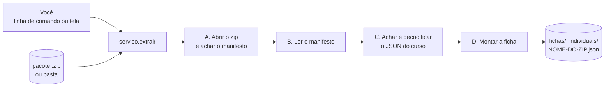
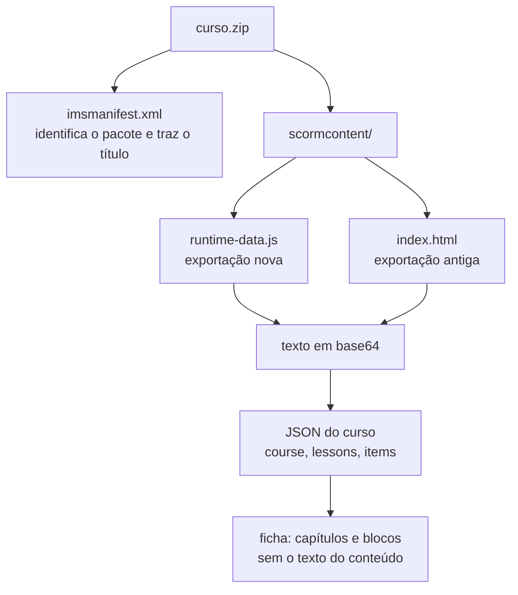
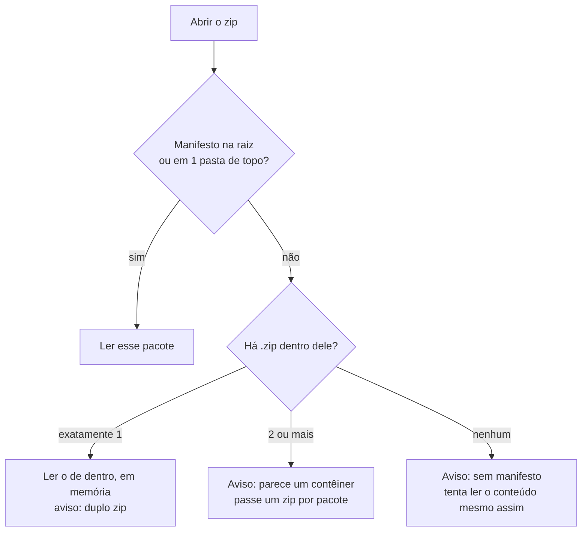
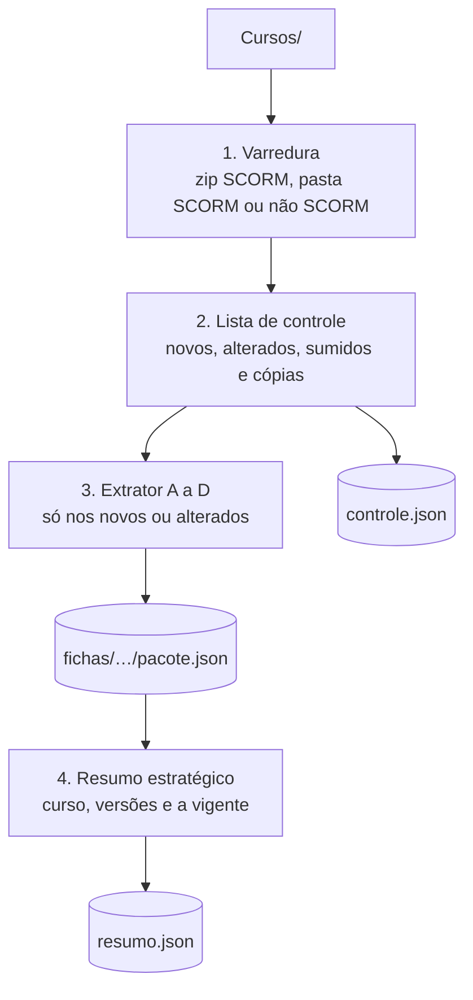

# Extrator de SCORM · documento técnico

> Guia rápido de uso: [extrator-scorm.md](extrator-scorm.md). Este arquivo é o detalhe de como funciona por dentro.


Recebe **um pacote SCORM** (um `.zip` ou uma pasta exportada do Articulate Rise 360) e devolve **um JSON** que descreve o curso: título, capítulos, quantidade de blocos e palavras, regras de conclusão e alertas. Não guarda o texto do conteúdo, só a estrutura. Apontado para a **pasta de cursos inteira**, faz o mesmo com todos os pacotes e monta um **resumo estratégico** (veja [o modo em lote](#o-modo-em-lote-mvp11)).

Nada é extraído no disco: o zip é lido em memória e a pasta é lida no lugar. As únicas coisas gravadas são os JSON de saída.

## O pipeline em uma figura



| Fase | Arquivo | O que faz |
|---|---|---|
| A | [leitura/fonte.py](leitura/fonte.py), [leitura/inventario.py](leitura/inventario.py) | Abre o zip **ou a pasta** pela mesma camada de leitura (`nomes`, `ler`, `tamanho`), calcula o `sha256` e acha o `imsmanifest.xml` (na raiz ou numa pasta de topo). |
| B | [leitura/manifesto.py](leitura/manifesto.py) | Lê do manifesto o identificador, o padrão SCORM (1.2 ou 2004), o título e se faltam arquivos declarados. |
| C | [leitura/formato.py](leitura/formato.py) | Acha o JSON do curso, que está escondido em base64, e o decodifica. |
| D | [estrutura/ficha.py](estrutura/ficha.py) | Transforma o JSON na ficha: curso, capítulos, tamanho, LMS, pacote e alertas. |
| — | [servico.py](servico.py) | Liga as fases. É o único lugar com a lógica; a linha de comando e a tela só chamam ele. |
| — | [interface/](interface) | `cli.py` (zip, pasta de um pacote ou pasta de cursos) e `tela.py` (aba **Pasta de cursos** e aba **Individual**). |

## Onde está o curso dentro do pacote

O curso inteiro é **um JSON codificado em base64**, dentro de um arquivo de `scormcontent/`. Há duas variantes de exportação.



A fase C tenta `runtime-data.js`, depois `index.html`. Se nenhum dos dois servir, procura em qualquer `.js` ou `.html` de `scormcontent/` um base64 grande que seja um curso Rise (e avisa).

## O que o zip pode ser (fase A)



## O que sai

Um arquivo por pacote, em `extrator_scorm/fichas/_individuais/` (fora do git). Rodar de novo regrava o mesmo arquivo. No modo em lote, as fichas ficam em `extrator_scorm/fichas/<caminho do pacote>.json`, junto do `controle.json` e do `resumo.json` (também fora do git); a lista das últimas versões vai para `Cursos/registro-de-cursos.json`.

| Bloco do JSON | Conteúdo |
|---|---|
| `curso` | id, título, descrição, autores, datas (criado, editado, publicado) e se foi publicado depois da última edição |
| `capitulos` | por capítulo: título, tipo (conteúdo ou quiz), blocos, palavras, interativos, verificações, HTML customizado; no quiz, nota mínima, tentativas e questões |
| `tamanho` | totais de capítulos, blocos, palavras, minutos de leitura estimados (200 palavras por minuto) e questões |
| `lms` | padrão exportado, como reporta e como conclui |
| `pacote` | nome, tamanho, `sha256` (de uma pasta: do conteúdo, arquivo por arquivo), versão do SCORM, ferramenta, onde o JSON estava e a `impressao_do_curso` (a mesma em pacotes diferentes é a mesma versão do curso) |
| `alertas` | o que merece olhar (abaixo) |
| `avisos` | o que aconteceu na leitura (abaixo) |

O que mais existe dentro do SCORM, e onde fica, está catalogado em [estrutura/disponiveis.py](estrutura/disponiveis.py).

### Três níveis de problema

| Nível | Quando | O que acontece |
|---|---|---|
| **Erro** (`ErroExtracao`) | arquivo inexistente, não é zip, zip corrompido | para e mostra a mensagem |
| **Aviso** (`avisos`) | zip dentro de zip, sem manifesto, formato desconhecido | continua e anota na saída |
| **Alerta** (`alertas`) | player em inglês, capítulo sem descrição, sem quiz, HTML customizado, arquivo declarado ausente | é uma observação sobre o curso, não sobre a leitura |

## Como rodar

```bash
uv run python -m extrator_scorm                          # abre a tela (aba Pasta de cursos)
uv run python -m extrator_scorm Cursos                   # lote: todos os cursos, com controle e resumo
uv run python -m extrator_scorm caminho/do/pacote.zip    # um pacote só: grava fichas/_individuais/pacote.json
```

Guia passo a passo: [extrator-scorm.md](extrator-scorm.md).

## O modo em lote (MVP1.1)

O modo em lote leva o mesmo extrator para a pasta `Cursos/` inteira. As fases A a D acima não mudam; entram etapas antes e depois delas. Só lê a pasta de cursos.



| Etapa | Arquivo | O que faz |
|---|---|---|
| 1. Varredura | [lote/varredura.py](lote/varredura.py) | Acha os pacotes: um `.zip` ou uma **pasta** com `imsmanifest.xml` na raiz. Empresa, curso e versão vêm do caminho `<Empresa>/<curso>/scorm/vN[/copias]`. Deixa o laboratório de fora. |
| 2. Controle | [lote/controle.py](lote/controle.py) | Calcula o `sha256` de cada pacote e compara com `controle.json` da execução anterior: **novo**, **alterado**, **sem mudança**, **cópia idêntica** (mesmo `sha256`; o principal é o que já era conhecido) e **sumido**. Guarda a execução anterior em `controle.anterior.json`. |
| 3. Lote | [lote/lote.py](lote/lote.py) | Extrai só o que precisa (novo, alterado ou sem ficha) e grava `fichas/<caminho>.json`. Um pacote com erro vira linha do relatório e **não** interrompe os outros. Pode ser interrompido sem deixar controle pela metade. |
| 4. Resumo | [lote/resumo.py](lote/resumo.py) | Agrupa por empresa e curso; cada versão traz título, publicação, capítulos, blocos, palavras, minutos, questões do quiz, alertas e quantos pacotes têm esse conteúdo. A **vigente** é a de maior número. Sem texto de conteúdo. |

**Só as últimas versões** (`--so-ultimas`, ou a caixa na tela): o lote extrai apenas os pacotes da maior `vN` de cada curso (zip, pasta e `copias/` dela; um pacote fora do padrão sempre entra). A varredura, o `sha256` e o resumo continuam completos: as versões antigas aparecem com a ficha que já existir ou com `nao_lida`, e uma execução completa depois lê o que faltou.

**Fontes da tela:** Ubuntu (comum) e SUSE Mono (relatório e JSON), de `fontes/arquivos/`, registradas no fontconfig antes de a janela abrir (`interface/fontes.py`). Por isso o projeto fixa o Python 3.14 do sistema em `.python-version`: o Python do `uv` (Tk 9 sem Xft) só enxerga 60 fontes antigas do X11.

**Autor de cada versão** (`lote/autores.py`): um nome por versão, **declarado em `Edicao_de_cursos`**, num `autor.json` dentro de cada pasta de versão (`Cursos/<Empresa>/<curso>/scorm/vN/autor.json`, com `{"autor": "Nome"}` ou `{"autor": null}`). O extrator só lê; `uv run python -m extrator_scorm.lote.autores --criar PASTA` cria os que faltam, vazios. Vale o `autor.json`; sem ele, o autor do Rise se for uma pessoa (a conta «Iaclube Help» não conta); sem esse, `null`. O autor do commit no git vai em `autor_sugerido.git`, só como pista. Resumo e `registro-de-cursos.json` ganham `autor`, `autor_origem` e `autor_sugerido`; o relatório lista o que ficou sem autor e as versões sem arquivo.

**Um JSON só:** toda execução grava `registro-de-cursos.json`, com a ficha **completa** da última versão (maior `vN`) de cada curso, em ordem de empresa e curso (`cursos[]` com `empresa`, `curso`, `versao`, `pacote`, `ficha`); `sem_ficha` lista a última versão que deu erro e `fora_do_padrao` os pacotes sem curso e versão. É o que o `resumo.json` **não** é: o resumo só traz números.

**Conteúdo repetido:** depois de ler, o resumo compara a `impressao_do_curso` de todos os pacotes que não são cópia idêntica e grava em `duplicados` os grupos de mesmo conteúdo (pasta e zip, zips, pastas; mesma versão ou não). Em `Cursos/`: 19 grupos, todos «pasta e zip» na mesma versão.

Pastas SCORM são **lidas direto, sem virar zip**: a ficha é a mesma que a do zip de mesmo conteúdo, só o bloco `pacote` muda. Para saber se dois pacotes são a mesma versão do curso, o `sha256` do arquivo não serve (a pasta extraída tem as quebras de linha dos arquivos do player trocadas); por isso a ficha traz `impressao_do_curso`, calculada sobre o JSON do curso.

Se a pasta não tiver nenhum pacote, o lote avisa e **não grava nada**, para um caminho errado não apagar o controle da execução anterior.
